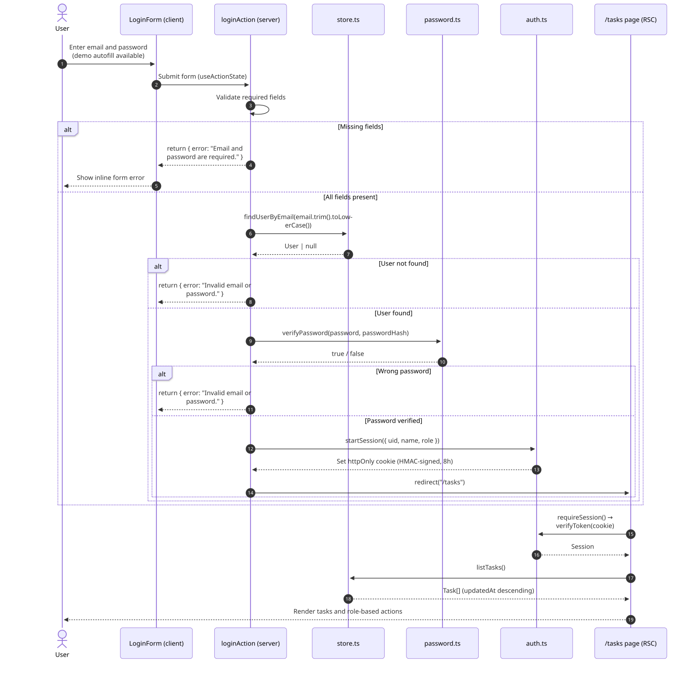
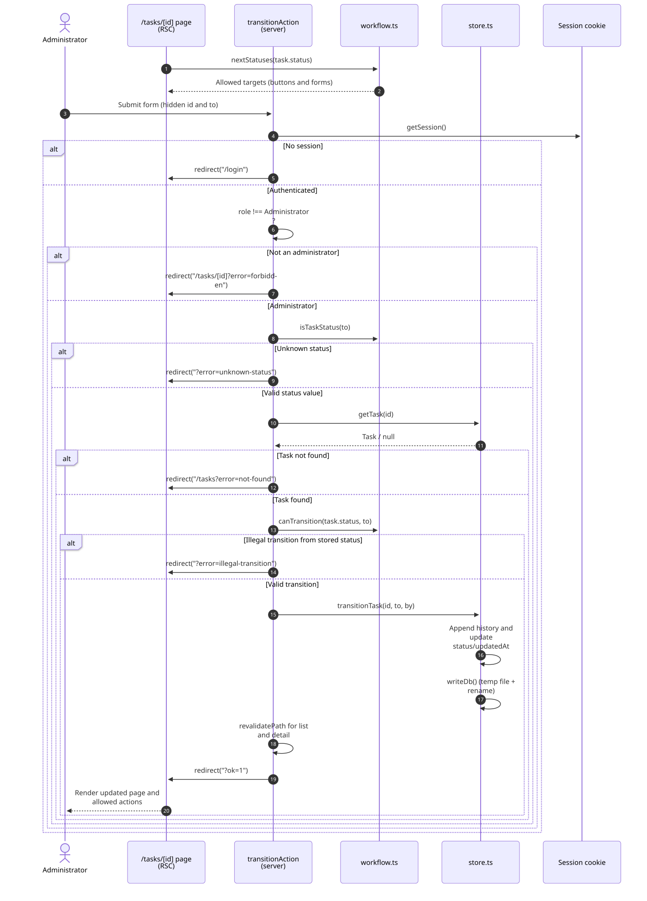

# Task Manager 架构与组件设计

> 本文档基于仓库当前代码（`task-manager/`）逐文件梳理，描述**整体架构、组件树、模块依赖、数据模型、关键流程与状态机权限**，并给出可执行的演进建议。文中所有路径、行号、函数名均对应实际代码。

| 项目 | 内容 |
| --- | --- |
| 项目路径 | `task-manager/`（Next.js App Router） |
| 技术栈 | Next.js **15.5.28** · React **19.1.0** · TypeScript 5（strict）· Tailwind CSS 4 |
| 运行时 | Node.js 单进程（`next dev` / `next start`），**无中间件、无外部数据库、无第三方认证库** |
| 数据存储 | 本地 JSON 文件 `data/db.json`（可用环境变量 `DB_PATH` 覆盖） |
| 会话 | HMAC-SHA256 签名的 payload 放入 httpOnly Cookie（`tm_session`，8 小时） |
| 口令 | Node 内置 `scrypt`（`salt:hash`），`timingSafeEqual` 比较 |
| 测试 | `node:test` + `tsx`，13 个用例（workflow 8 + store 5） |
| 代码规模 | 23 个 TS/TSX 文件、共 **1 710 行**（应用代码 19 个文件 1 563 行 · 测试 2 个文件 134 行 · 配置 2 个文件 13 行） |

---

## 0. 一页看懂

```text
浏览器（React 19）
  ├─ 页面导航  →  Next.js RSC 页面（server 组件）  →  lib/store.ts  →  data/db.json
  └─ 表单提交  →  Server Actions（lib/actions.ts）→  领域校验（auth/workflow/password）→  store 写入
```

**五条设计主线**（代码里都能找到对应位置）：

1. **服务端组件优先，客户端组件只做交互**：页面全部是 RSC（直接读数据、直接渲染），只有 3 个组件带 `"use client"`（`LoginForm`、`NewTaskForm`、`SubmitButton`）。
2. **变更收口到 Server Actions**：5 个 action 全部在 `lib/actions.ts`，页面只负责渲染表单。
3. **状态表是唯一事实来源**：`lib/workflow.ts` 的 `TRANSITIONS` 同时被详情页（渲染哪些按钮）、`transitionAction`（是否接受）、测试（哪些组合必须失败）读取。
4. **权限校验两次，目的不同**：页面隐藏按钮是"体验"，Server Action 里再判角色是"安全"（代码注释与 README 都明确写了这一点）。
5. **存储只有一个窄接口**：应用代码里只有 `lib/store.ts` 碰文件系统（测试用 `fs` 创建临时目录），换 SQLite/Postgres 时主要改这一个文件。

> 计数口径："行数"均按文件实际内容行统计（不含末尾换行）；配置指 `next.config.ts` 与 `next-env.d.ts`。`data/db.json` 为运行期数据，不计入代码行数。

---

## 1. 整体架构



*图 1 系统整体架构：浏览器 → Next.js Server（RSC 页面 + Server Actions + lib 领域模块）→ JSON 数据文件*

### 1.1 分层职责

> 图中按**运行域**把服务端合并为一组（Next.js Server），下表按**职责**细分为 5 个部分——两处描述同一套代码，不是两种架构。

| 层 | 组成（文件） | 职责 | 硬约束 |
| --- | --- | --- | --- |
| ① 浏览器 | 页面 HTML/RSC payload、3 个客户端组件 | 展示、表单输入、pending 状态、确认弹窗 | 不持有任何权限判断；不发自定义 fetch，只用表单 action |
| ② 页面层（RSC） | `app/layout.tsx`、`app/page.tsx`、`app/login/page.tsx`、`app/tasks/page.tsx`、`app/tasks/new/page.tsx`、`app/tasks/[id]/page.tsx`、`app/not-found.tsx` | 取会话、取数据、过滤、渲染；把"允许的动作"算好后交给按钮 | 只读数据；写操作一律交给 action |
| ③ 变更层（Server Actions） | `lib/actions.ts` | 解析表单 → 认证 → 授权 → 业务校验 → 调用 store → `revalidatePath` / `redirect` | **3 个任务类 action**（create/transition/delete）都先 `getSession()`；login/logout 不属于受保护操作；任何一步失败**不写数据** |
| ④ 领域模块 | `lib/workflow.ts`、`lib/auth.ts`、`lib/password.ts`、`lib/format.ts`、`lib/types.ts` | 状态迁移规则、会话签名/校验、口令哈希、时间格式化、类型定义 | 纯函数为主，不碰 React 与 fs |
| ⑤ 存储层 | `lib/store.ts` | 读写 `data/db.json`、种子数据、ID 生成、原子写 | **应用代码中唯一**的 `fs` 使用者 |

### 1.2 部署与运行形态

| 维度 | 现状 |
| --- | --- |
| 进程模型 | 单个 Next.js Node 进程（`next dev` 开发 / `next build && next start` 生产） |
| 外部依赖 | **无**：不连数据库、不调第三方认证、不依赖缓存服务 |
| 数据持久化 | 项目目录下 `data/db.json`（首次访问自动落种子数据）；测试用 `DB_PATH` 指向临时文件 |
| 中间件 | 未使用 `middleware.ts`；权限在页面（`requireSession/requireAdmin`）与 action 两处判定 |
| 适用场景 | 单实例、少量用户、评审/演示；**不适合多副本或并发写入**（§8 已列边界） |

### 1.3 读路径与写路径的分离（这个项目最关键的架构选择）

| | 读路径（查询/渲染） | 写路径（变更） |
| --- | --- | --- |
| 入口 | RSC 页面直接调用 | 客户端组件表单 → Server Action |
| 调用链 | `page.tsx` → `listTasks()/getTask()` → `readDb()` | `actions.ts` → 校验 → `createTask/transitionTask/deleteTask` → `writeDb()` |
| 是否经过 HTTP API | 否（服务端直接渲染） | 否（Server Action 是内部 RPC，但**仍是公开 POST 端点**，所以服务端必须校验） |
| 失败表现 | `notFound()` / `redirect("/login")` | `return { error }`（表单内提示）或 `redirect("?error=...")`（页面红条） |
| 数据新鲜度 | 两个数据页（`/tasks`、`/tasks/[id]`）显式 `dynamic = "force-dynamic"`，每次请求重新读文件；其余页因调用 `cookies()` 自动转为动态渲染 | 写后 `revalidatePath()`，随后 `redirect` 触发重新渲染 |

> 这意味着：**没有 API 层**。项目不暴露 REST 接口，页面与变更都走 Next.js 内部通道；对外集成（移动端/第三方）属于未来演进项（§8）。

---

## 2. 组件树（页面 × 组件 × 动作）



*图 2 页面/组件/动作依赖树：实线为组合关系，页面依赖 lib 读取数据，客户端组件只通过 Server Action 变更*

### 2.1 页面（全部为 Server Component）

| 路由 | 文件 | 权限守卫 | 数据来源 | 交互入口 |
| --- | --- | --- | --- | --- |
| `/` | `app/page.tsx` | 无（读会话后重定向） | `getSession()` | — |
| `/login` | `app/login/page.tsx` | 已登录则跳 `/tasks` | `getSession()` | `LoginForm` |
| `/tasks` | `app/tasks/page.tsx` | `requireSession()` | `listTasks()` + `?status` 过滤 + 各状态计数 | 新建入口（仅管理员）、每行删除（仅管理员）、状态筛选 Tab |
| `/tasks/new` | `app/tasks/new/page.tsx` | `requireAdmin()`（非管理员被重定向回 `/tasks`） | 无（纯表单页） | `NewTaskForm` |
| `/tasks/[id]` | `app/tasks/[id]/page.tsx` | `requireSession()` | `getTask(id)` + `nextStatuses(status)` | 迁移按钮（仅管理员）、删除（仅管理员）、历史时间线 |
| 404 | `app/not-found.tsx` | — | — | 返回列表 |

### 2.2 组件清单

| 组件 | 文件 | 类型 | Props | 依赖 | 职责 |
| --- | --- | --- | --- | --- | --- |
| `LoginForm` | `components/LoginForm.tsx`（103 行） | **client** | 无 | `loginAction` | 受控输入、`useActionState` 显示错误、演示账号一键填充 |
| `NewTaskForm` | `components/NewTaskForm.tsx`（89 行） | **client** | 无 | `createTaskAction` | 标题/描述/负责人输入、错误提示、`pending` 禁用 |
| `SubmitButton` | `components/SubmitButton.tsx`（45 行） | **client** | `children, pendingLabel, variant, className, confirmText` | `useFormStatus` | 统一按钮样式 + pending 文案 + 原生 `confirm` 二次确认 |
| `StatusBadge` | `components/StatusBadge.tsx`（14 行） | server | `status` | `STATUS_META` | 状态徽标（颜色/圆点/文案来自状态表） |
| `TopBar` | `components/TopBar.tsx`（52 行） | server | `session` | `logoutAction` | 顶栏、当前用户/角色、退出登录 |

**客户端组件仅 3 个**，且都只做"输入 + 提交"，不读数据、不判断权限——这是 RSC 架构下最省心的边界。

### 2.3 组件与动作的调用矩阵

| 动作（lib/actions.ts） | 调用方 | 认证 | 授权 | 主要副作用 |
| --- | --- | --- | --- | --- |
| `loginAction` | `LoginForm` | — | 校验邮箱/口令 | 写会话 Cookie、`redirect("/tasks")` |
| `logoutAction` | `TopBar` | —（删 Cookie 即可） | — | 删会话 Cookie、`redirect("/login")` |
| `createTaskAction` | `NewTaskForm` | `getSession()` | 仅 Administrator | 建任务（`Pending`）→ `revalidatePath` → 跳详情 |
| `transitionAction` | 详情页每个迁移表单 | `getSession()` | 仅 Administrator + 迁移合法性 | 追加 history、改状态 → `revalidatePath` → `?ok=1` |
| `deleteTaskAction` | 列表页/详情页删除表单 | `getSession()` | 仅 Administrator | 从数组移除任务 → `revalidatePath` → `/tasks?ok=deleted` |

> 3 个任务类 action 共享同一套骨架：`getSession()` → 角色 → 业务校验 → 落库 → `revalidatePath`。`loginAction` 只做口令校验并写 Cookie，`logoutAction` 只删 Cookie，二者不需要会话断言。新增任务类 action 时应复制这套骨架，而不是从页面里"顺手写一下"。

---

## 3. lib 模块与依赖方向

| 模块 | 行数 | 主要导出 | 被谁引用 | 说明 |
| --- | --- | --- | --- | --- |
| `lib/types.ts` | 41 | `Role`, `TaskStatus`, `TASK_STATUSES`, `Task`, `TaskEvent`, `User`, `PublicUser` | 几乎所有模块 | 叶子模块，只有类型与常量 |
| `lib/workflow.ts` | 76 | `TRANSITIONS`, `nextStatuses`, `canTransition`, `isTerminal`, `isTaskStatus`, `STATUS_META` | 页面、action、测试 | **状态机唯一来源** + 状态展示元数据 |
| `lib/password.ts` | 23 | `hashPassword`, `verifyPassword` | store（种子）、actions | scrypt + 固定时间比较 |
| `lib/auth.ts` | 93 | `SESSION_COOKIE`, `Session`（类型）, `createToken`, `verifyToken`, `getSession`, `requireSession`, `requireAdmin`, `startSession`, `endSession` | 页面、actions | HMAC 会话；页面用 `require*`，action 用 `getSession` |
| `lib/store.ts` | 263 | `listTasks`, `getTask`, `findUserByEmail`, `createTask`, `transitionTask`, `deleteTask` | 页面、actions | 应用代码中唯一碰 `fs` 的模块；含种子数据与原子写 |
| `lib/actions.ts` | 112 | 5 个 action + `FormState` | 客户端组件、页面 | `"use server"`；变更收口 |
| `lib/format.ts` | 41 | `formatDateTime`, `formatDate`, `relativeTime`, `initials` | 页面、TopBar | 固定 `Asia/Shanghai` 时区展示 |
| `lib/types.ts` 之外无循环依赖 | — | — | — | 依赖方向单向：页面/组件 → actions → domain → store → types |

```text
types.ts  ←  workflow.ts / password.ts / auth.ts / store.ts / format.ts
                 ↑                ↑            ↑
              actions.ts  ────────┴────────────┘
                 ↑
       页面（RSC） / 客户端组件
```

**三条边界规则**（评审时应重点看这三处）：

1. 页面与组件**不允许**直接 `import ... from "node:fs"`，也不允许直接写 `data/db.json`；
2. 客户端组件**不允许** import `lib/store.ts`（它依赖 `node:fs`，会打包失败），只能 import action 或纯函数；
3. 状态相关的文案/颜色**不允许**在页面里硬编码，必须走 `STATUS_META`。

---

## 4. 数据模型



*图 3 数据模型：`data/db.json` 的 users / tasks（history 内嵌）与 TS 类型对应关系。users 与 tasks 之间**没有物理外键**（`createdBy` / `assignee` 存姓名字符串），因此图中不画关系线；Mermaid ER 图无法表达"非外键"

### 4.1 类型定义（`lib/types.ts`）

```ts
export type Role = "Administrator" | "Viewer";
export const TASK_STATUSES = ["Pending", "Approve", "To Do", "Done", "Cancelled"] as const;
export type TaskStatus = (typeof TASK_STATUSES)[number];

export type TaskEvent = { at: string; from: TaskStatus | null; to: TaskStatus; by: string; note: string };
export type Task = {
  id: string; title: string; description: string; assignee: string;
  status: TaskStatus; createdBy: string; createdAt: string; updatedAt: string;
  history: TaskEvent[];
};
export type User = { id: string; name: string; email: string; passwordHash: string; role: Role };
export type PublicUser = Pick<User, "id" | "name" | "email" | "role">;
```

### 4.2 存储文件结构（`data/db.json`）

```json
{
  "users": [
    { "id": "u_admin",  "name": "Yuheng Yang", "email": "admin@example.com",  "passwordHash": "salt:hash", "role": "Administrator" },
    { "id": "u_viewer", "name": "Yuheng Yang",   "email": "viewer@example.com", "passwordHash": "salt:hash", "role": "Viewer" }
  ],
  "tasks": [
    {
      "id": "T-004",
      "title": "Status transition guard",
      "description": "Keep Pending → Approve → To Do → Done in one table shared by the UI and the server.",
      "assignee": "Yuheng Yang",
      "status": "Pending",
      "createdBy": "Yuheng Yang",
      "createdAt": "2026-10-24T06:02:00.000Z",
      "updatedAt": "2026-10-24T06:02:00.000Z",
      "history": [
        { "at": "2026-10-24T06:02:00.000Z", "from": null, "to": "Pending", "by": "Yuheng Yang", "note": "Created" }
      ]
    }
  ]
}
```

> 上面只截取了 1 条任务（T-004，仍在 Pending，所以只有 1 条 history）。种子数据实际包含 6 条任务（T-001 到 T-006），状态覆盖 Done / To Do / Approve / Pending / Cancelled，历史条数与状态一致。

> 时间戳由 `store.ts` 的 `at(daysAgo, hour, minute)` **按当前日期相对生成**，上例为示意值，不同时间运行会得到不同时间戳。仓库中的 `data/db.json` 在演示过程中可能新增任务（当前为 8 条）。

### 4.3 存储实现要点（`lib/store.ts`）

| 关注点 | 实现 | 位置 |
| --- | --- | --- |
| 数据文件路径 | `process.env.DB_PATH ?? path.join(process.cwd(), "data", "db.json")` | `store.ts` 顶部 |
| 首次运行 | `readDb()` 读失败 → `seed()` 生成 2 用户 + 6 任务（含历史）→ 写盘 | `readDb / seed` |
| 损坏处理 | **任何**读取/`JSON.parse` 失败都会走种子重建（并非只判断文件不存在）→ JSON 损坏时会被静默重置，生产使用前应备份 | `readDb()` |
| 原子写 | 先写 `` `${DB_PATH}.tmp` ``（即 `data/db.json.tmp`），再 `renameSync` 覆盖，避免半个 JSON | `writeDb()` |
| ID 生成 | 取现有 `T-xxx` 的最大数字 + 1，补零三位 | `nextTaskId()` |
| 历史记录 | `transitionTask()` 同一函数里 `history.push` + 改 `status/updatedAt` + 落盘 | `transitionTask()` |
| 列表排序 | `listTasks()` 按 `updatedAt` 倒序（内存排序） | `listTasks()` |
| 查询能力 | 仅"取全量 + 内存过滤"；无分页、无搜索、无索引 | `listTasks()` |
| 测试隔离 | `test/store.test.ts` 在 import 前设置 `DB_PATH` 到临时目录 | 测试文件顶部 |

> **命名口径**：`assignee` 存的是**姓名字符串**（不是 user id），`createdBy` / `history.by` 同样存姓名。好处是渲染无需 join；代价是用户改名后历史记录不会跟着变（当前无用户管理，暂不构成问题）。
---

## 5. 关键流程

### 5.1 登录与会话



*图 4 登录流程：表单 → Server Action → 查用户 → scrypt 校验 → 写 HMAC 会话 Cookie → 重定向列表*

| 步骤 | 代码位置 | 说明 |
| --- | --- | --- |
| 1. 表单提交 | `components/LoginForm.tsx` | `useActionState(loginAction)`，失败时把错误渲染在表单内 |
| 2. 必填校验 | `lib/actions.ts:loginAction` | 缺字段返回 `{ error }`，不查库 |
| 3. 查用户 | `findUserByEmail()` | 邮箱 `trim + toLowerCase` 后比较 |
| 4. 校验口令 | `verifyPassword()` | 仅当用户存在时才校验口令（`!user || !verifyPassword(...)` 短路）；两种情况返回**同一句提示**（防枚举） |
| 5. 写会话 | `startSession()` → `cookies().set` | httpOnly + SameSite=Lax + 8h；生产环境加 Secure |
| 6. 跳转 | `redirect("/tasks")` | 登录页本身若已有会话会直接跳列表 |
| 7. 守卫 | `requireSession()` / `requireAdmin()` | 页面级；action 里用 `getSession()` 自行判断并返回错误 |

**失败分支**：缺字段 → "Email and password are required."；账号或口令错 → "Invalid email or password."；未登录访问受保护页 → `redirect("/login")`。

### 5.2 状态迁移（本项目最核心的写流程）



*图 5 状态迁移流程：会话 → 角色 → 状态值 → 迁移合法性（以库中真实状态为准）→ 写库 + 历史 → 重定向*

| 顺序 | 检查/动作 | 失败处理 |
| --- | --- | --- |
| 1 | `getSession()` | `redirect("/login")` |
| 2 | `session.role !== "Administrator"` | `redirect("/tasks/[id]?error=forbidden")` |
| 3 | `isTaskStatus(to)`（防伪造状态值） | `?error=unknown-status` |
| 4 | `getTask(id)` | `redirect("/tasks?error=not-found")` |
| 5 | `canTransition(task.status, to)`（**用库里的当前状态**，不是表单里的） | `?error=illegal-transition` |
| 6 | `transitionTask()`：`history.push` + 改状态/时间 + 原子写 | 无（文件写失败会抛错） |
| 7 | `revalidatePath("/tasks")`、`revalidatePath("/tasks/[id]")`；`redirect("?ok=1")` | — |

**错误提示链路**：action 用 `?error=code` 重定向 → 详情页 `ERRORS` 映射为人类可读文案 → 渲染红色横条。列表页同理（`FLASH` 映射 `ok/error`）。

> 注意：当前 `transitionAction` 调用 `transitionTask(id, to, session.name)` 时**没有传 `note`**，所以运行期新增的 history 备注恒为空；只有种子数据带备注。若要支持"审批意见"，在 action 里读一个 `note` 字段并透传即可。

**并发与失败边界**：迁移是"读全量 → 改内存 → 整文件写回"，两个并发请求可能互相覆盖（详见 §8.2 #2）；文件写入失败会抛错，由 Next.js 错误页兜底。

### 5.3 创建与删除

| 流程 | 入口 | 检查 | 写入 | 收尾 |
| --- | --- | --- | --- | --- |
| 创建 | `/tasks/new` 的 `NewTaskForm` | 会话 → 角色（仅管理员）→ 标题 ≥ 4、描述 ≥ 10（**只有最小长度，无最大长度**；`assignee` 是自由文本，不校验是否为真实用户） | `createTask()`：ID 自增、`status=Pending`、写首条 history | 跳详情页 |
| 删除 | 列表行 / 详情页删除表单 | 会话 → 角色（仅管理员）→ 原生 `confirm` | `deleteTask()`：从数组移除（**硬删除**）；删除不存在的 id 时返回 `false`，但 action 仍按成功提示 | 回列表 `?ok=deleted` |

> 注意：删除是**硬删除**，且不留历史。若改成软删除，改动范围是 `lib/types.ts`（加 `deletedAt`）与 `lib/store.ts`（创建时置 `null`、`listTasks`/`getTask` 过滤、`deleteTask` 改为写时间戳）；页面与 action 的**函数签名不变**，无需改动。

### 5.4 读路径示例（列表页）

```text
GET /tasks?status=Pending
  → app/tasks/page.tsx：requireSession() 取会话
  → listTasks()：readDb() → 全量读取 → updatedAt 倒序
  → 内存过滤：按 ?status + 统计每个状态数量
  → RSC 渲染表格：StatusBadge、相对时间、删除按钮（仅管理员）
```

两个数据页（`app/tasks/page.tsx`、`app/tasks/[id]/page.tsx`）显式声明了 `export const dynamic = "force-dynamic"`，因此每次请求都会重新读文件、重新渲染，不会出现"数据改了页面没变"的缓存问题；其余页面因调用 `cookies()` 自动转为动态渲染。代价是失去静态优化（对内部小工具可接受）。

---

## 6. 状态机与角色权限



*图 6 五状态流转：Pending → Approve → To Do → Done，任意非终态可取消；所有迁移仅管理员可触发*

### 6.1 状态与迁移表（`lib/workflow.ts`）

| 状态 | 含义 | 可迁移到 | 是否终态 |
| --- | --- | --- | --- |
| `Pending` | 新建，待管理员审核 | `Approve`, `Cancelled` | 否 |
| `Approve` | 已批准，待排期 | `To Do`, `Cancelled` | 否 |
| `To Do` | 已排期，执行中 | `Done`, `Cancelled` | 否 |
| `Done` | 完成 | —（终态） | 是 |
| `Cancelled` | 已取消 | —（终态） | 是 |

迁移表代码（唯一来源）：

```ts
export const TRANSITIONS: Record<TaskStatus, readonly TaskStatus[]> = {
  Pending: ["Approve", "Cancelled"],
  Approve: ["To Do", "Cancelled"],
  "To Do": ["Done", "Cancelled"],
  Done: [],
  Cancelled: [],
};
```

### 6.2 角色 × 能力

| 能力 | Administrator | Viewer | 判定位置 |
| --- | --- | --- | --- |
| 查看任务列表/详情 | ✅ | ✅（只读） | `requireSession()` |
| 查看状态历史 | ✅ | ✅ | 详情页直接渲染 `history` |
| 新建任务 | ✅ | ❌ | 页面 `requireAdmin()` + `createTaskAction` 角色校验 |
| 执行状态迁移 | ✅ | ❌ | 详情页隐藏表单 + `transitionAction` 角色校验 |
| 删除任务 | ✅ | ❌ | 页面 `isAdmin` 条件 + `deleteTaskAction` 角色校验 |
| 访问 `/tasks/new` | ✅ | ❌（重定向回列表） | `requireAdmin()` |

> **注意**：当前实现的业务口径是"**管理员推进流程，普通用户只读**"。需求原文只要求"两种角色 + 五状态切换"，没有规定 Viewer 能不能提交任务；这里选择只读是合理的简化（README 中也明确写着 "Viewers read only"）。若要让 Viewer 也能提交任务，需要改**三处**：① `app/tasks/new/page.tsx` 的 `requireAdmin()` 改为 `requireSession()`；② `createTaskAction` 的角色判断放行 Viewer；③ 列表页"新建"入口的显示条件。状态机与存储无需改动。

### 6.3 权限为什么校验两次

```text
页面：isAdmin ? 渲染迁移表单 : 渲染"Viewers cannot change status"
服务端：transitionAction 里 session.role !== "Administrator" → redirect(?error=forbidden)
```

- 页面判断是**体验**（不该出现的按钮不出现，减少误操作）；
- 服务端判断是**安全边界**（Server Action 本质是公开 POST 端点，可以手工构造）；
- 代码里没有任何"只靠前端"的授权，这是本项目在安全上最值得肯定的一点。

---

## 7. 运行、配置与测试

### 7.1 命令与账号

```bash
npm install
npm run dev     # http://localhost:3000
npm test        # 13 个用例：workflow 8 + store 5
npm run build && npm start   # 以生产方式运行
```

| 账号 | 口令 | 角色 |
| --- | --- | --- |
| `admin@example.com` | `admin123` | Administrator |
| `viewer@example.com` | `viewer123` | Viewer |

### 7.2 配置项

| 环境变量 | 缺省行为 | 用途 |
| --- | --- | --- |
| `SESSION_SECRET` | 使用代码内的开发默认值（**生产必须覆盖**） | 会话 HMAC 密钥 |
| `DB_PATH` | `<cwd>/data/db.json` | 数据文件位置；测试用它指向临时文件 |

### 7.3 测试覆盖

| 测试文件 | 用例数 | 覆盖点 |
| --- | --- | --- |
| `test/workflow.test.ts` | 8 | 初始状态可选项、主链路、不能跳步、不能倒退、终态、每个状态都有定义、目标状态合法、拒绝伪造状态 |
| `test/store.test.ts` | 5 | 首次读取落种子、口令哈希与校验、新建固定 Pending、迁移同时更新状态/时间/历史、删除后可查不到 |

测试策略的亮点：`store.test.ts` 在 `import` 之前把 `DB_PATH` 指向 `mkdtemp` 临时目录，**跑测试不会污染真实数据**。

---

## 8. 质量评估与演进建议

### 8.1 做得好的地方

| # | 优点 | 证据 |
| --- | --- | --- |
| 1 | 状态规则集中：改规则只改一个对象，页面/服务端/测试三方自动一致 | `lib/workflow.ts` 的 `TRANSITIONS` |
| 2 | 权限双层校验，且服务端以大括号条件提前返回，逻辑一眼可读 | `lib/actions.ts` |
| 3 | 写操作前完成全部校验，"任何一步不过都不写数据" | `transitionAction` 顺序 |
| 4 | 存储封装成窄接口，替换成本低（作者在 README 里也点明了这一点） | 只有 `store.ts` 引 `node:fs` |
| 5 | 原子写（临时文件 + rename）避免半截 JSON | `store.ts:writeDb` |
| 6 | 无第三方运行时依赖（仅 next/react/react-dom），安装与部署简单 | `package.json` |
| 7 | 客户端组件极少（3 个），交互与数据边界清晰 | `components/*` |

### 8.2 已知边界与风险

| # | 边界 | 影响 | 建议 |
| --- | --- | --- | --- |
| 1 | 每次变更**全量读 + 全量写** `db.json` | 数据量上百条后变慢；并发写会丢更新 | 换 SQLite/Prisma：`store.ts` 改异步，页面与 action 的调用点补 `await`（约 8 处） |
| 2 | 读-改-写之间无锁 | 两个同时提交的迁移可能相互覆盖 | 加 `version` 字段 + 条件更新（乐观锁），或在 store 内做写队列 |
| 3 | 会话不可吊销 | 退出只能删本地 Cookie，旧 token 在 8h 内仍可重放 | 服务端存会话/用户版本号 |
| 4 | 无 CSRF Token | 依赖 `SameSite=Lax` + Server Action 同源校验 | 对高风险操作加 Origin 校验或 token |
| 5 | 硬删除 | 删除后无痕迹、不可恢复 | 改软删除（`deletedAt`）+ 列表过滤 |
| 6 | 无分页/搜索 | 任务多时列表页变重 | 在页面层加 `?page`/`?q`，或在 store 提供过滤参数 |
| 7 | 无用户管理 | 账号只能改种子代码 | 增加 `/admin/users`（仍需先补口令重置流程） |
| 8 | `SESSION_SECRET` 有开发默认值 | 忘记配置时生产环境密钥可预测 | 生产启动时校验环境变量并 fail-fast |
| 9 | `status` 用字符串字面量存 JSON | 数据库层无约束，手改文件可写非法状态 | 换数据库时用枚举/CHECK 约束兜底 |
| 10 | `readDb()` 对**任何**读取/解析失败都重建种子 | 手工改坏 JSON 会被静默重置，演示数据丢失 | 先判断 `ENOENT`（仅文件不存在才播种），解析失败则报错并备份原文件 |
| 11 | 迁移不写备注 | 运行期 `history[].note` 恒为空，无法记录审批意见 | `transitionAction` 增加 `note` 字段并透传给 `transitionTask()` |
| 12 | 删除不存在的 id 仍提示成功 | 误导操作者（实际未删除） | 判断 `deleteTask()` 返回值，`false` 时 `?error=not-found` |
| 13 | 输入只有最小长度校验，无最大长度；`assignee` 为自由文本 | 超长文本（title/description/assignee）可写入；负责人可写任意字符串 | 增加最大长度校验；`assignee` 改为用户下拉（需要用户列表接口） |

### 8.3 演进路线（按投入产出排序）

| 阶段 | 动作 | 影响面 |
| --- | --- | --- |
| P1 | `store.ts` 换 SQLite + Prisma（函数签名改为 async） | `store.ts` + 调用点补 `await`（两个数据页、`actions.ts` 各 3~4 处）；页面/action 的**逻辑**不变 |
| P1 | 加乐观锁 `version` + 条件更新 | `store.ts` + `actions.ts` 的迁移函数 |
| P2 | 软删除 `deletedAt` + 列表过滤 | `types.ts`（加字段）+ `store.ts`（默认值/过滤/删除逻辑）；页面与 action 不改 |
| P2 | 服务端会话表 / 用户版本号（支持强制下线） | `auth.ts` + 登录 action |
| P3 | 分页、搜索、导出 CSV | 列表页 + store 查询参数 |
| P3 | 抽出 `app/api/tasks/route.ts` 供外部集成 | 复用 `store.ts` 与 `workflow.ts`，无需改页面 |

---

## 附录 A：文件清单（按行数）

| 文件 | 行数 | 角色 |
| --- | --- | --- |
| `lib/store.ts` | 263 | 存储（含种子数据） |
| `app/tasks/[id]/page.tsx` | 221 | 任务详情页 |
| `app/tasks/page.tsx` | 187 | 任务列表页 |
| `lib/actions.ts` | 112 | 5 个 Server Actions |
| `components/LoginForm.tsx` | 103 | 登录表单（client） |
| `lib/auth.ts` | 93 | 会话签名与守卫 |
| `components/NewTaskForm.tsx` | 89 | 新建表单（client） |
| `lib/workflow.ts` | 76 | 状态表 + 展示元数据 |
| `app/tasks/new/page.tsx` | 71 | 新建页（仅管理员） |
| `app/login/page.tsx` | 72 | 登录页 |
| `components/TopBar.tsx` | 52 | 顶栏 + 退出 |
| `components/SubmitButton.tsx` | 45 | 提交按钮（client） |
| `lib/format.ts` | 41 | 时间/头像格式化 |
| `lib/types.ts` | 41 | 类型与状态常量 |
| `app/layout.tsx` | 30 | 根布局 |
| `lib/password.ts` | 23 | scrypt 哈希/校验 |
| `app/not-found.tsx` | 23 | 404 |
| `app/page.tsx` | 7 | 根路由重定向 |
| `components/StatusBadge.tsx` | 14 | 状态徽标 |
| `test/workflow.test.ts` | 54 | 状态机测试 |
| `test/store.test.ts` | 80 | 存储层测试 |

| **小计（21 个业务/测试文件）** | **1 697** | 应用代码 1 563（19 个）+ 测试 134（2 个） |
| `next.config.ts` | 7 | 脚手架配置 |
| `next-env.d.ts` | 6 | 脚手架类型声明 |
| **合计（23 个 TS/TSX）** | **1 710** | 另有 `eslint.config.mjs`、`postcss.config.mjs`、`tsconfig.json` 等非 TS/TSX 配置未计入 |

> 行数口径：按文件实际内容行统计（不含末尾换行）。`data/db.json` 是运行期数据，不计入。

## 附录 B：图表再生成

图表源码在 `docs/diagrams/src/*.mmd`，渲染产物在 `docs/images/`。修改源码后执行：

```bash
# 首次需安装 mermaid-cli 到 <project>/temp/render-tools
PUPPETEER_SKIP_DOWNLOAD=true <bundled-pnpm> --dir temp/render-tools add @mermaid-js/mermaid-cli
node docs/tools/render.mjs            # 全部渲染（SVG 1400px 宽 + 2x PNG）
node docs/tools/render.mjs 06-workflow-state.mmd   # 单张
```

| 图 | 源码 | 内容 |
| --- | --- | --- |
| 图 1 系统架构 | `01-system-architecture.mmd` | 3 个运行域（浏览器 / Next.js Server / 数据）对应 §1.1 的 5 个职责部分 + 横切；读、写两条路径 |
| 图 2 组件树 | `02-component-tree.mmd` | 页面 → 组件 → action |
| 图 3 数据模型 | `03-data-model.mmd` | users / tasks / history |
| 图 4 登录时序 | `04-login-sequence.mmd` | 登录 + 会话 + 守卫 |
| 图 5 迁移时序 | `05-transition-sequence.mmd` | 7 步校验与写入 |
| 图 6 状态机 | `06-workflow-state.mmd` | 五状态与角色约束 |


